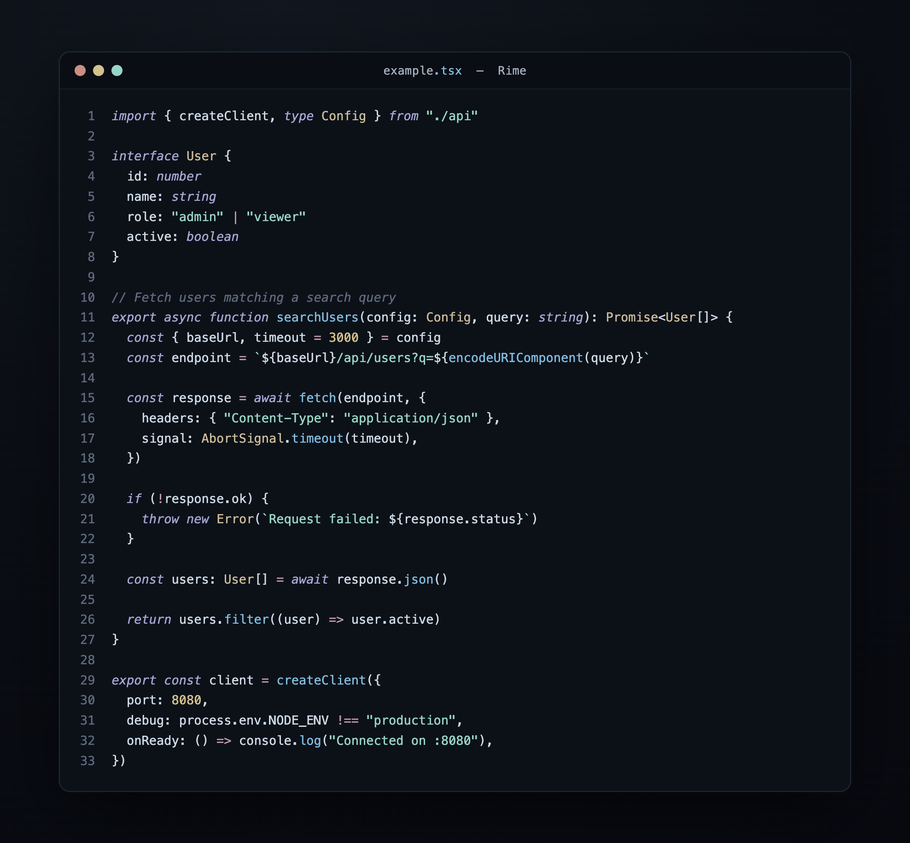

<h1 align="center">Rime</h1>

<p align="center">
  An icy, near-black dark theme with periwinkle keywords and frost accents.<br />
  Built for Neovim, VS Code, Zed, terminals, tmux, and CLI tools.
</p>

<p align="center">
  
</p>

## Features

- **Single source of truth** — every color lives in `palette.json`, all outputs are generated
- **WCAG AA contrast** — validated at build time (accents land 7–11:1 on the background)
- **Neovim plugin integrations** — Telescope, cmp, gitsigns, mini.nvim, noice, trouble, flash, snacks, and more
- **Treesitter + LSP semantic tokens** — full highlighting with role-based accents
- **Terminal + CLI targets** — Kitty, Alacritty, WezTerm, Ghostty, iTerm2, foot, Windows Terminal, tmux, fzf, bat, delta, lazygit, OpenCode
- **Editors** — VS Code and Zed
- **Transparent mode** and **configurable italics**

## Palette

Accents are **role-based** — each color maps to what it highlights.

<table>
  <tr>
    <td><br /><strong>keyword</strong><br /><code>#a6a6d4</code><br /><sub>keywords, imports, primitives</sub></td>
    <td><br /><strong>func</strong><br /><code>#82bce0</code><br /><sub>functions, methods</sub></td>
    <td><br /><strong>type</strong><br /><code>#cdbb9a</code><br /><sub>types, classes</sub></td>
    <td><br /><strong>string</strong><br /><code>#98d4c4</code><br /><sub>strings, additions</sub></td>
  </tr>
  <tr>
    <td><br /><strong>number</strong><br /><code>#d4c28c</code><br /><sub>numbers, constants</sub></td>
    <td><br /><strong>operator</strong><br /><code>#c49ab0</code><br /><sub>operators, flow</sub></td>
    <td><br /><strong>tag</strong><br /><code>#7ec4be</code><br /><sub>tags, markup</sub></td>
    <td><br /><strong>error</strong><br /><code>#cc8e84</code><br /><sub>errors, deletions</sub></td>
  </tr>
</table>

**Backgrounds** (dark → light): `shadow #07090f` · `dim #0a0d13` · `base #0c1118` · `surface0 #161d28` · `surface1 #1f2835` · `surface2 #293343`
**Foregrounds:** `text #cdd9e5` · `subtext #a6b3c2` · `overlay #7d8a9c` · `comment #5f6b7e`

## Installation

### Neovim

#### lazy.nvim

```lua
{
  "danfry1/rime",
  lazy = false,
  priority = 1000,
  config = function()
    require("rime").setup()
    vim.cmd("colorscheme rime")
  end,
}
```

<details>
<summary>packer.nvim</summary>

```lua
use {
  "danfry1/rime",
  config = function()
    require("rime").setup()
    vim.cmd("colorscheme rime")
  end,
}
```

</details>

#### Options

All options are optional — defaults work out of the box.

```lua
require("rime").setup({
  transparent = false, -- set to true to use your terminal's background
  italics = true,      -- set to false to disable italic comments/keywords
  palette_overrides = {
    foregrounds = { text = "#d4dfe9" },   -- example tweak
    accents = { keyword = "#b0b0dc" },    -- tweak any accent
  },
  custom_highlights = function(colors, variant)
    -- colors contains: backgrounds, foregrounds, accents, ansi, special
    return {
      Normal = { bg = "#0c1118" },
      MiniDiffSignAdd = { fg = colors.accents.string },
    }
  end,
})
```

Palette overrides are applied first — all built-in highlight groups and `custom_highlights` see the modified palette.

### VS Code

Copy `editors/vscode/themes/rime-color-theme.json` into a VS Code theme extension, or open the repo folder and press `F5` to launch an Extension Development Host, then pick **Rime** via `Preferences: Color Theme`.

### Zed

```sh
# Copy to Zed's local themes directory
cp editors/zed/themes/rime.json ~/.config/zed/themes/
```

Then select **Rime** from the theme picker.

### Terminals

Generated config lives under `terminals/`:

| Terminal | File |
|---|---|
| Kitty | `terminals/kitty/rime.conf` (`include` it from `kitty.conf`) |
| Alacritty | `terminals/alacritty/rime.toml` (`import` in `alacritty.toml`) |
| WezTerm | `terminals/wezterm/rime.toml` |
| Ghostty | `terminals/ghostty/rime` (`theme = rime`) |
| iTerm2 | `terminals/iterm2/rime.itermcolors` (import via Preferences → Profiles → Colors) |
| foot | `terminals/foot/rime.ini` |
| Windows Terminal | `terminals/windows-terminal/rime.json` (paste into `schemes`) |

### Tmux

```sh
# ~/.tmux.conf
source-file /path/to/rime/tmux/rime-theme.conf
```

### CLI tools

- **fzf** — `source cli/fzf/rime.sh` in your `~/.zshrc` / `~/.bashrc`
- **bat** — copy `cli/bat/rime.tmTheme` into `$(bat --config-dir)/themes/`, run `bat cache --build`, set `--theme=rime`
- **delta** — `[include] path = /path/to/rime/cli/delta/rime.gitconfig`, then `delta --features rime`
- **lazygit** — merge `cli/lazygit/rime.yml` into your lazygit config
- **OpenCode** — `cli/opencode/rime.json`

## Building

Rime is generated from `palette.json` with [theme-template](https://github.com/danfry1/theme-template):

```sh
bun install
bun run generate           # writes all targets + validates WCAG contrast
bun test                   # contrast + generation tests
bash scripts/nvim-smoke.sh # headless Neovim load check
```

## License

MIT
